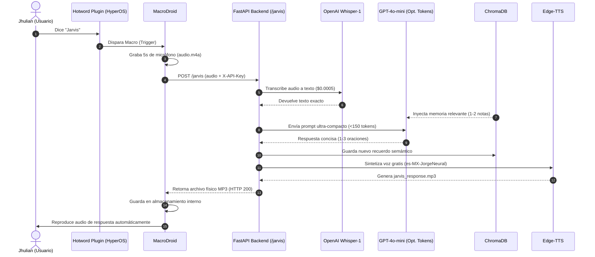

# 🤖 JARVIS - Asistente de Voz Personal con IA

Asistente por voz inteligente para Android (HyperOS) conectado a un backend de alto rendimiento con **FastAPI**, **OpenAI Whisper & GPT-4o-mini** (ultra-bajo consumo de tokens), **ChromaDB** (memoria episódica persistente) y **Edge-TTS** (síntesis de voz ultra-realista y 100% gratuita).

---

## 📋 Arquitectura del Flujo de Trabajo



---

## 💰 Optimización Extrema de Tokens y Costos

Hemos diseñado la integración de OpenAI para que el costo sea prácticamente cero sin perder calidad:

1. **Whisper-1 para Transcripción:**
   * Whisper cobra por segundo de audio ($0.006 por minuto completo).
   * Una nota de voz de 5 segundos cuesta apenas **$0.0005 USD** (medio milésimo de centavo).
2. **GPT-4o-mini como Cerebro Conversacional:**
   * Es el modelo más avanzado y económico de OpenAI ($0.15 por millón de tokens de entrada).
   * **System Prompt ultra-compacto:** Reducido a menos de 75 tokens para no inflar el prompt en cada turno.
   * **Inyección Quirúrgica de Memoria:** ChromaDB recupera únicamente los 2 recuerdos más relevantes en lugar de volcar todo el historial.
   * **Límite `max_tokens=180`:** Impide que el modelo divague o genere párrafos largos, asegurando respuestas rápidas y directas para ser habladas.
   * **Costo por interacción:** Entre **30 y 80 tokens totales** (~$0.00001 USD por mensaje). Con $1 USD tienes para más de 1,500 conversaciones.
3. **Edge-TTS para la Voz de Retorno:**
   * **0 tokens de OpenAI gastados en voz.** Usamos el motor neuronal de Microsoft Edge (`es-MX-JorgeNeural`), que es 100% gratuito e ilimitado.

---

## ⚡ Opciones de Hosting Recomendadas (Gratis y Conveniente)

### 🥇 Opción 1: Tu PC + Cloudflare Tunnel (La mejor para 0 latencia y 0 costo)
* **Costo:** $0.00 para siempre.
* **0 Cold Start:** El servidor responde al instante sin dormirse jamás.
* **Persistencia total:** ChromaDB guarda los datos físicamente en tu PC.
* **Cómo usarlo:** Ejecutas el backend con `.\start_server.ps1` y en otra terminal ejecutas:
  ```powershell
  cloudflared tunnel --url http://localhost:8000
  ```
  Te dará una URL HTTPS como `https://xxx.trycloudflare.com/jarvis` accesible desde tu teléfono en cualquier red móvil.

### 🥈 Opción 2: Render (Plan Gratuito con Docker)
* **Costo:** $0.00.
* Subes este repositorio a GitHub y creas un Web Service en [Render.com](https://render.com) usando el [Dockerfile](file:///c:/Users/Jhulian/Downloads/JARVIS/Dockerfile).
* Para evitar que Render se duerma tras 15 minutos de inactividad, configuras un ping gratuito en [UptimeRobot.com](https://uptimerobot.com) que llame a `https://tu-servicio.onrender.com/health` cada 10 minutos.

---

## 🚀 Puesta en Marcha del Backend

### 1. Variables de Entorno (.env)
Tu archivo [.env](file:///c:/Users/Jhulian/Downloads/JARVIS/.env) ya está configurado con tu clave activa:
```env
OPENAI_API_KEY=tu_clave_de_openai
JARVIS_API_KEY=jarvis_secret_key_12345
AI_PROVIDER=openai
OPENAI_MODEL=gpt-4o-mini
VOICE_NAME=es-MX-JorgeNeural
```

### 2. Iniciar el Servidor
```powershell
.\start_server.ps1
```
Acceso a la documentación interactiva: `http://localhost:8000/docs`

---

## 📱 Configuración en Xiaomi HyperOS (El Oído)

Los teléfonos Xiaomi (MIUI / HyperOS) cierran aplicaciones en segundo plano por defecto. Aplica estos 3 ajustes:

1. **Permisos y Batería de Hotword Plugin & MacroDroid:**
   * Mantén presionado el icono de **MacroDroid** > **Información de la aplicación**.
   * Activa **Inicio automático** (Autostart).
   * En **Ahorro de batería**, cámbialo a **Sin restricciones**.
   * En **Otros permisos**, activa: *Mostrar en pantalla de bloqueo*, *Mostrar ventanas emergentes en segundo plano*, *Modificar ajustes del sistema*.
   * Repite exactamente los mismos pasos para la aplicación **Hotword Plugin**.
2. **Fijar en Memoria RAM (Candado):**
   * Abre la vista de aplicaciones recientes de HyperOS.
   * Mantén presionada la ventana de MacroDroid y pulsa el icono del **Candado**.
3. **Entrenar la Palabra Clave:**
   * Abre **Hotword Plugin**, graba tu voz diciendo *"Jarvis"* y calibra la sensibilidad.

---

## 📲 Configuración en MacroDroid (El Puente y La Boca)

Crea una Macro llamada **"JARVIS Voice Assistant"**:

### 1. Disparador (Trigger)
* `+` > **Plugins** > **Hotword Plugin** > Selecciona tu palabra clave *"Jarvis"*.

### 2. Acciones (Actions)

#### Acción 1: Grabar Micrófono
* `+` > **Medios** > **Grabar sonido**.
* Duración: **5 segundos**.
* Formato: `.m4a` o estándar.
* Ruta: `MacroDroid/grabacion_jarvis.m4a`.

#### Acción 2: Petición HTTP (POST al Backend)
* `+` > **Conectividad** > **Petición HTTP**.
* **Método:** `POST`
* **URL:** `https://tu-túnel.trycloudflare.com/jarvis` (o tu URL de Render).
* **Cabeceras de Petición (Request Headers):**
  * Nombre: `X-API-Key`
  * Valor: `jarvis_secret_key_12345`
* **Cuerpo de la Petición:**
  * Selecciona **Multipart / Form-data**
  * Nombre del parámetro: `audio`
  * Archivo adjunto: `MacroDroid/grabacion_jarvis.m4a`
* **Respuesta del Servidor:**
  * Marcar **Guardar respuesta en archivo**.
  * Ruta de destino: `MacroDroid/respuesta_jarvis.mp3`
  * Marcar: *Sobrescribir si ya existe*.

#### Acción 3: Reproducir Sonido de Respuesta
* `+` > **Medios** > **Reproducir sonido**.
* Archivo: `MacroDroid/respuesta_jarvis.mp3`.
* Canal: **Multimedia**.
